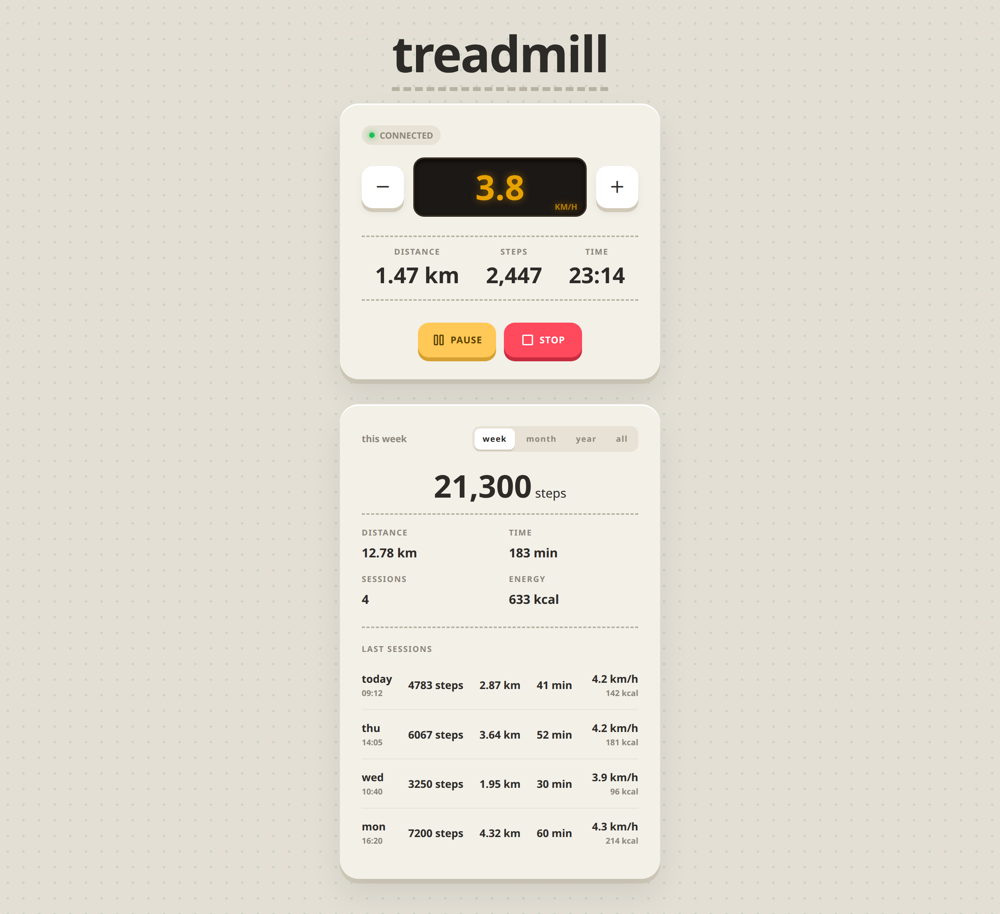

# Treadmill

A small companion app to control a Bluetooth (FTMS) treadmill from the browser and keep track of your walking sessions.

<p align="center">
  
</p>

## Features

- Connects to the treadmill over Bluetooth (using the Fitness Machine Service protocol) and reconnects automatically
- Start, pause(!), resume and stop the treadmill
- Adjust the speed between 1.0 and 6.0 km/h
- Live distance, estimated steps and time, pushed to every open browser over WebSockets
- History of sessions per week, month, year or all time (only sessions longer than 100 m are saved)

## Requirements

- Linux host with a Bluetooth adapter and BlueZ (`bluetoothd`) running; BLE goes through BlueZ over D-Bus
- A treadmill that supports the Bluetooth FTMS profile
- Node.js 26 (see `mise.toml`) when running without Docker

## Configuration

| Variable        | Default     | Description                                                                   |
| --------------- | ----------- | ----------------------------------------------------------------------------- |
| `DEVICE_NAME`   | `FS-7F5603` | Bluetooth name the treadmill advertises                                       |
| `STEP_LENGTH_M` | `0.6`       | The step length (in meters) used to estimate steps, update in `public/app.js` |

The web UI and API are available on `localhost:3033`.

## Running with Docker

Needs `bluez` running on the host; the container talks to it through the host's D-Bus socket.

```sh
touch treadmill.db
docker compose up -d --build
```

Sessions are stored in `./treadmill.db`; create it before the first start, otherwise Docker mounts an empty directory there. To use another treadmill, add `DEVICE_NAME` under `environment:` in `docker-compose.yml`. Logs: `docker compose logs -f`.

On Ubuntu, AppArmor blocks D-Bus calls from the default Docker profile, which is why the docker-compose file sets `apparmor:unconfined`.

## Development / Running with node

```sh
sudo apt-get install bluetooth bluez libbluetooth-dev libudev-dev
npm install
npm start
```

Then open http://localhost:3033.

## API

| Method | Path                    | Description                                                  |
| ------ | ----------------------- | ------------------------------------------------------------ |
| GET    | `/api/session`          | Current session (`503` if the treadmill is disconnected)     |
| GET    | `/api/sessions?period=` | Saved sessions: `period` is `week`, `month`, `year` or `all` |
| POST   | `/api/start`            | Start the treadmill                                          |
| POST   | `/api/pause`            | Pause the treadmill and session                              |
| POST   | `/api/resume`           | Resume the treadmill and session                             |
| POST   | `/api/stop`             | Stop the treadmill                                           |
| POST   | `/api/speed?speed=`     | Set the speed in 0.01 km/h (e.g. `350` = 3.5 km/h)           |

Live updates (connection state, current session, state changes) are broadcast over a WebSocket on the same port.

## License

MIT
